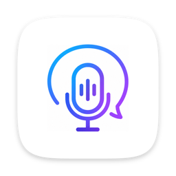
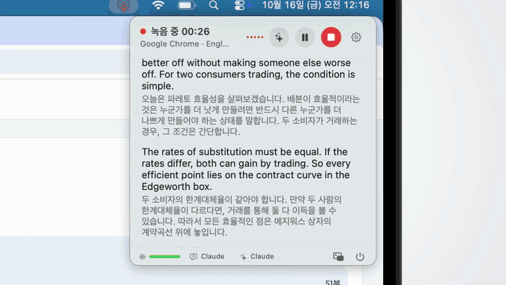
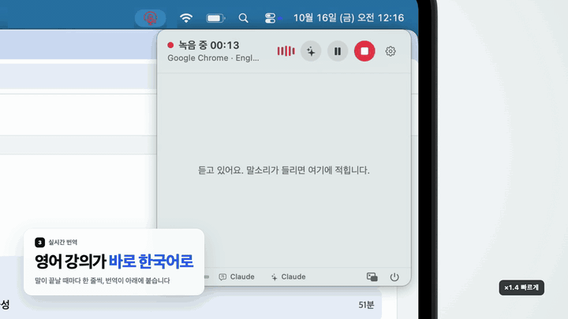
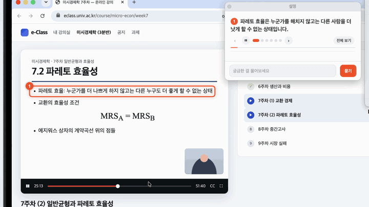

  

<h1 align="center">Study AI</h1>

  강의를 받아 적고, 외국어 강의는 한국어로 옮기고, 
  모르는 장면은 AI 가 화면을 짚어 가며 설명해 주는 메뉴바 앱

  <a href="https://github.com/dakcoe/study-AI/releases/latest"><b>다운로드</b></a> ·
  <a href="#설치방법">설치방법</a> ·
  <a href="#기능">기능</a> ·
  <a href="#개인정보">개인정보</a> ·
  <a href="#환경">환경</a>

  
  
  
  
  

  

온라인 강의든 강의실 수업이든, 메뉴바에서 한 번 눌러 받아 적기 시작하세요. 영어·일본어 강의는 줄마다 한국어 번역이 붙고,
슬라이드가 이해되지 않을 땐 버튼 하나로 AI 가 지금 화면과 방금 들은 말을 함께 보고 짚어 가며 설명합니다.
무료 Groq 키 하나면 되고(Groq 가입은 무료), Study AI 자체에는 계정도 구독도 없습니다.

> [!NOTE]
> 지금은 Mac 에서 쓸 수 있습니다. **Windows 판은 따로 만들고 있습니다.**

## 기능

### 받아 적기

- **소리 출처를 골라서.** 시스템 전체 소리, 크롬·줌 같은 특정 앱, 마이크 가운데 고릅니다. 앱을 고르면 그 앱 소리만 받아 다른 소리가 섞이지 않습니다.
- **내 목소리도 함께.** 온라인 수업에서 내가 발표하거나 질문한 말도 같이 받아 적습니다.
- **일시정지와 이어 쓰기.** 녹음 중에 소리 출처나 언어를 바꿔도 같은 기록에 이어집니다.
- **지어낸 문장 거르기.** 조용한 구간에서 받아쓰기 AI 가 지어내는 흔한 문장을 걸러 냅니다.
- **작은 창.** 최근 한 줄과 번역만 보이는 작은 띠로 줄여 강의 화면을 가리지 않습니다.

  

### 번역

- **줄마다 한국어로.** 영어·일본어 강의는 말이 끝날 때마다 줄 아래에 번역이 붙습니다. 앞 줄을 함께 보내 문맥을 맞춥니다.
- **쓸 AI 고르기.** 기본은 무료 Groq 입니다. Claude·Gemini·GPT 키를 넣으면 번역과 화면 설명에 각각 고를 수 있고, 실패하면 Groq 로 대신합니다.
- **남은 한도 막대.** 팝업 아래 막대로 오늘 남은 무료 한도를 한눈에 봅니다.

### 설명해줘

- **화면을 짚어 가며.** 지금 화면과 최근 강의 내용을 보고 설명하는 곳을 ①②③ 으로 짚은 뒤, 카드에서 짧은 영상처럼 장면별로 설명합니다.
- **그림까지.** 단계·표·공식·관계도를 함께 그립니다.
- **스크롤을 따라서.** 슬라이드를 스크롤하면 화면 위 표시가 따라갑니다.
- **이어서 질문.** 카드 아래 칸에 물어보면 그 순간 화면과 앞의 설명을 이어서 답합니다.
- **AI 지침.** "2학년 수준으로, 수식은 한 단계씩" 처럼 원하는 설명 방식을 적어 두면 늘 반영합니다.

  

### 지난 기록

- **저절로 저장.** 받아 적은 글과 소리가 함께 저장됩니다. 저장 위치는 iCloud 등으로 바꿀 수 있습니다.
- **한 줄씩 다시 듣기.** 줄 왼쪽 재생 버튼으로 그 줄의 말만 다시 듣습니다.
- **다시 받아 적기.** 저장된 소리로 기록 전체를 다시 받아 적습니다.
- **이름 붙이기와 내보내기.** 기록에 이름을 붙이고 다른 폴더로 내보냅니다.
- **새 버전 알림.** 새 버전이 나오면 앱이 알려 줍니다.

## 설치방법

1. [최신 버전](https://github.com/dakcoe/study-AI/releases/latest)에서 DMG 를 내려받아 열고, `Study AI` 를 `Applications` 폴더로 끌어 넣습니다.
2. 처음 열 때 "확인되지 않은 개발자" 창이 뜨면 DMG 안의 `설치 안내.txt` 를 따라 주세요.
3. 앱이 안내하는 대로 [무료 Groq 키](https://console.groq.com/keys)를 넣고, 마이크·화면 녹화 권한을 허용합니다.

## 개인정보

- API 키와 기록은 **내 Mac 에만** 저장됩니다. Study AI 계정도, 사용 기록 수집도 없습니다.
- 받아쓰기·번역에는 소리와 글자가, 설명 버튼을 누를 때는 그 순간의 화면이 고른 AI 서비스로 전송됩니다. 누르기 전에 개인 창은 가려 주세요.
- 화면 녹화 권한은 다른 앱의 **소리를 받는 데만** 씁니다. 화면을 저장하지 않습니다.

## 환경

- macOS 13 (Ventura) 이상
- Apple 칩과 Intel 모두 지원 (Intel 은 대략 2017년 이후 모델)
- 무료 [Groq](https://console.groq.com/keys) 키
